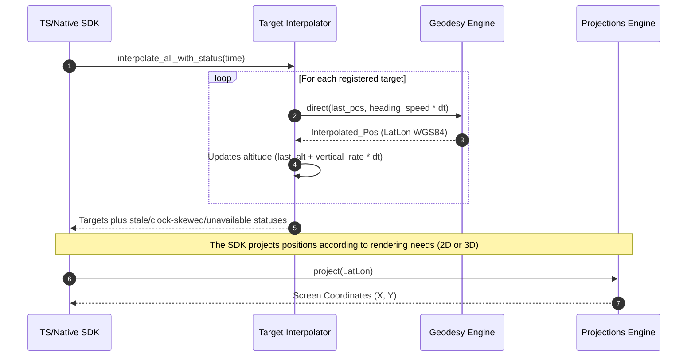
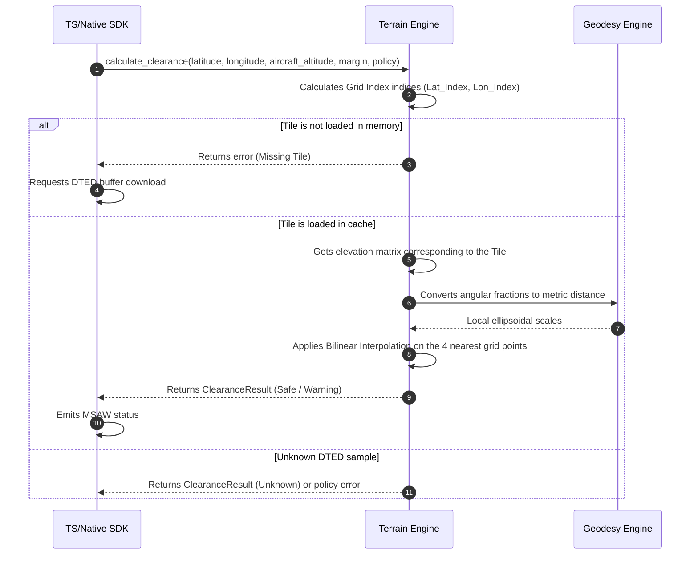

# Core architecture

Pure mathematical/domain engines in `core/`. API signatures live in the [core reference](../../reference/core.md), and [Map Core](../map-core.md) is a separate crate.

## 1. Olayer Core Component Diagram

The Olayer Core operates as a passive logical container. It does not manage network or disk I/O directly (especially in the WebGL/WASM environment), receiving data through interoperability bridges (WASM and FFI) and providing processed responses.

```mermaid
graph TB
    %% C4 node styles
    classDef external fill:#999999,stroke:#888888,color:#ffffff,stroke-width:2px;
    classDef container fill:#1168BD,stroke:#0f5ca7,color:#ffffff,stroke-width:2px;
    classDef component fill:#438DD5,stroke:#3b7cbd,color:#ffffff,stroke-width:2px;
    classDef bridge fill:#FFF9C4,stroke:#FBC02D,color:#5D4037,stroke-width:2px;
    classDef core fill:#E1F5FE,stroke:#0288D1,color:#01579B,stroke-width:2px;

    %% External Elements/Other Containers
    subgraph SDK_Layers ["Client SDKs"]
        ts_sdk["📦 Olayer TS SDK<br>[TS Container]"]:::container
        native_sdk["📦 Olayer Native SDK<br>[Rust Container]"]:::container
    end

    subgraph Olayer_Core_Container ["Container Boundary: Olayer Core"]
        %% Interoperability
        wasm_bridge["🔗 Bridge WASM (wasm-bindgen)<br>[WASM Interop]"]:::bridge
        ffi_bridge["🔗 C-FFI Bridge (cbindgen)<br>[Native Interop]"]:::bridge

        %% Internal Components
        geodesy["📐 Geodesy Engine<br>[Component]<br>WGS84 ellipsoidal calculations and ECEF conversions."]:::core
        camera["📷 Camera Engine<br>[Component]<br>CameraState management and View-Proj matrices for 2D/2.5D/3D."]:::core
        projections["🗺️ Projections Engine<br>[Component]<br>Cartographic matrices and LCC, Stereographic, and Mercator projections."]:::core
        terrain["⛰️ Terrain Engine (DTED/RGB/COG)<br>[Component]<br>O(1) altitude spatial indexer and 2.5D profile."]:::core
        sld_parser["📄 SLD Parser<br>[Component]<br>XML parser for Styled Layer Descriptor (OGC) styling."]:::core
        symbol_registry["🎖️ Symbol Registry<br>[Component]<br>Decoder and builder of tactical symbols (NATO/ICAO)."]:::core
        interpolator["⏱️ Target Interpolator<br>[Component]<br>State prediction and Dead Reckoning of dynamic geodetic targets."]:::core
        aero["🛫 Aeronautical Engine<br>[Component]<br>AIXM 5.1 & GeoJSON-Aviation ingestion and spatial containment."]:::core
        weather["⛈️ Weather Engine<br>[Component]<br>Radar dBZ colorizer, wind barbs, isolines, and SIGMET hazards."]:::core
        volumetric["📦 Volumetric Engine<br>[Component]<br>3D airspace polyhedrons and flight trajectory ribbons."]:::core
        declutter["🏷️ Declutter Engine<br>[Component]<br>8-octant force-directed label anti-cluttering."]:::core
    end

    %% Input Relationships
    ts_sdk -->|Invokes routines via JS| wasm_bridge
    native_sdk -->|Invokes natively / FFI| ffi_bridge

    %% WASM Bridge Connections
    wasm_bridge -->|Invokes / Controls| camera
    wasm_bridge -->|Injects binary / Queries| terrain
    wasm_bridge -->|Injects XML / Configures| sld_parser
    wasm_bridge -->|Queries SIDC| symbol_registry
    wasm_bridge -->|Registers / Interpolates| interpolator
    wasm_bridge -->|Parses / Queries| aero
    wasm_bridge -->|Colorizes / Contours| weather
    wasm_bridge -->|Extrudes 3D Meshes| volumetric
    wasm_bridge -->|Solves Label Layout| declutter

    %% FFI Bridge Connections
    ffi_bridge -->|Invokes / Controls| camera
    ffi_bridge -->|Injects binary / Queries| terrain
    ffi_bridge -->|Injects XML / Configures| sld_parser
    ffi_bridge -->|Queries SIDC| symbol_registry
    ffi_bridge -->|Registers / Interpolates| interpolator
    ffi_bridge -->|Parses / Queries| aero
    ffi_bridge -->|Colorizes / Contours| weather
    ffi_bridge -->|Extrudes 3D Meshes| volumetric
    ffi_bridge -->|Solves Label Layout| declutter

    %% Internal Core Dependencies
    camera -->|Requires projections| projections
    camera -->|Requires Earth models| geodesy
    projections -->|Requires Earth models| geodesy
    terrain -->|Requires LLA-ECEF conversion| geodesy
    interpolator -->|Requires distance/heading calculation| geodesy
    symbol_registry -->|Requires parsed rules| sld_parser
    aero -->|Requires polygon containment| geodesy
    weather -->|Requires polygon containment| geodesy
    volumetric -->|Requires ECEF conversion| geodesy
    declutter -->|Requires spatial math| geodesy

    linkStyle 0,1,2,3,4,5,6,7,8,9,10,11,12,13,14,15,16,17 stroke:#555,stroke-width:1.5px;
```

---

## Module designs

- [geodesy](geodesy/arch.md)
- [projections](projections/arch.md)
- [camera](camera/arch.md)
- [terrain](terrain/arch.md)
- [sld](sld/arch.md)
- [symbol_registry](symbol_registry/arch.md)
- [interpolator](interpolator/arch.md)
- [aeronautical](aeronautical/arch.md)
- [weather](weather/arch.md)
- [volumetric](volumetric/arch.md)
- [declutter](declutter/arch.md)

See [terrain/altitude usage](../../guides/terrain.md), [WCS grids](../../guides/maps/wcs-terrain.md), and [shared polygon triangulation](../../guides/maps/wfs.md#polygon-fills-and-interior-holes) for current integration behavior.

## 3. Critical Core Data Flows

### 3.1 Target Projection and Drawing Pipeline
This flow illustrates how movement states are interpolated three-dimensionally on the globe and subsequently projected by the client SDK:

### 3.2 Vertical Alert Processing (MSAW)
This flow describes how the `Terrain Engine` calculates ground altitude on demand in $O(1)$ to emit terrain collision warnings.

---

> [!NOTE]
> **Memory Management Policies:** The Core container does not have a garbage collector. In the WebAssembly environment, the TypeScript SDK must actively manage the lifecycle of Rust objects. For each instance generated by the Core via `wasm-bindgen` that goes out of scope in the SDK, the corresponding `.free()` method must be called to deallocate the linear memory.

> [!IMPORTANT]
> **Thread-Safety:** Core engines are not a substitute for host synchronization. In particular, mutable terrain/interpolator state must not be accessed concurrently without host-side locking. Native hosts should serialize writes and coordinate reads according to the owning SDK's threading model.
