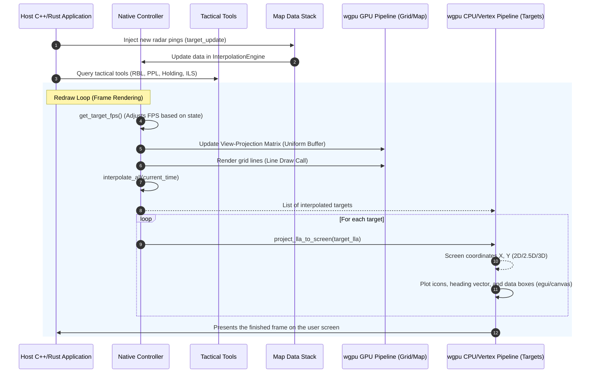

# Native SDK architecture

The native SDK owns controller/provider integration, GPU resources and C-FFI around the pure engines. Hosts own the window, device, render attachments, event loop and submission. The desktop demo is one host, not the SDK's mandatory execution environment.

| Component | Design |
|---|---|
| Controller and mode/camera state | [Native controller](native_controller/arch.md) |
| Layer ordering/visibility | [Layer manager](native_layer_manager/arch.md) |
| HTTP/filesystem adapters and source caches | [Map data stack](native_map_data_stack/arch.md) |
| Grid, terrain, raster and WFS rendering | [WGPU pipeline](wgpu_gpu_pipeline/arch.md) |
| CPU projection and target drawing | [CPU/vertex pipeline](wgpu_cpu_vertex_pipeline/arch.md) |
| C interoperability | [C-FFI bridge](c_ffi_bridge/arch.md) |
| Tactical tools | [Tools](tools/arch.md) |

Use the [native API reference](../../reference/native.md) for signatures, [map guides](../../guides/maps/README.md) for WMS/WFS/WCS, and [shared depth](../../guides/maps/depth.md) for compatible native render passes.

## Native Interaction and Flow Diagram

The diagram below illustrates the high-level cooperation of the native components during a typical radar tactical rendering frame:

